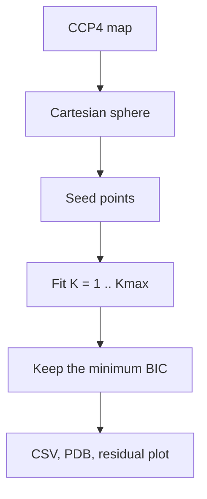
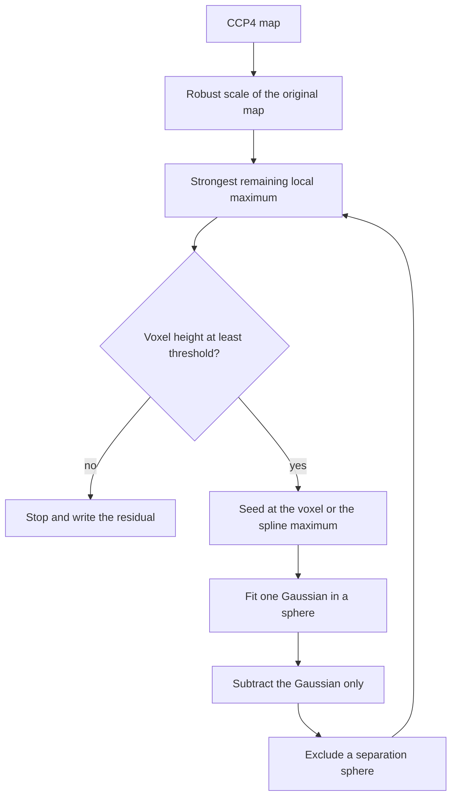

# Workflows

The library implements two positive-peak workflows. The notebooks add two single-peak fits, one axis-aligned and one fully rotated, that also accept negative difference density. This chapter is the procedure. The formulas and the noise model are in [Theory](theory.md). File layouts are in [Outputs](outputs.md).

## Which workflow to run

| | Joint library | Sequential library | Axis-aligned notebook | Full-covariance notebook |
| --- | --- | --- | --- | --- |
| Components in one fit | \(1 \ldots K_{\max}\), one shared background | one Gaussian and its own baseline | one | one |
| Amplitude | non-negative | non-negative | signed | signed |
| Shape | isotropic, or full \(\Sigma = LL^\top\) | isotropic, or full \(\Sigma = LL^\top\) | diagonal \(\Sigma\) on \(x,y,z\) | full \(\Sigma = LL^\top\) |
| Center | fixed at a local maximum, or free in the ROI | fixed at the seed, or free within `max_shift`. The seed is the detected voxel, or a spline maximum in its neighborhood | refined inside the fit sphere | fixed at the detected extremum |
| How many peaks | BIC chooses \(K\) | threshold, exclusion, and `n_peaks` | score threshold and minimum distance | score threshold and minimum distance |
| Map update | none | subtract the Gaussian, keep the baseline | none | none |

Use the joint fit when the peaks of interest sit inside one sphere and the question is how many Gaussians that sphere supports. Use the sequential fit when the peaks are spread through the map and each accepted feature should be removed before the next search. Use the notebooks to inspect a single signed extremum, including negative difference density, or to see the CCP4 indexing written out beside the fit.

BIC chooses \(K\) inside the shape you configured. It does not choose between an isotropic Gaussian and a full covariance. Run both settings and compare the written BIC values if that choice is the question. Those values share the same formula and the same voxels only when the ROI and the map are the same.

## Shared geometry

Both library programs read the CCP4 grid with `gemmi.read_ccp4_map(..., setup=False)`. The array, the start indices, the axis permutation, and the unit-cell orthogonalization stay as stored. Coordinates of every Gaussian are Cartesian ångströms. Index arithmetic is used only to pick up voxel values.

Voxels outside the sampled array are never wrapped around. A sphere that hangs off the edge of a crop simply contains fewer points. The joint fit refuses a region of interest with fewer than 30 finite voxels. A sequential one-peak fit skips a seed with fewer than 35 finite voxels.

The density values are the numbers stored in the map. Nothing rescales them to electrons or to a global \(\sigma\). The sequential threshold is the only library step that normalizes a height, and it uses a robust scale of the original map, documented below.

## Joint fit

`python -m xfel_gaussian.multi_peaks_gaussian` resolves the `multi_peaks` section and then does the following.

1. **Choose the sphere.** `center` is a Cartesian point in Å. When it is `null`, the center is the strongest finite voxel in the whole map (`nanargmax`). On a local crop of one site that is usually the site. On a full unit cell it is the global maximum, which may be a different place. Set `center` when the map contains more than one region of interest. `radius` is the Euclidean radius of the sphere in Å. The index window is expanded with the inverse of the grid-step matrix so an oblique cell still covers that sphere.

2. **Seed the components.** Densities at or below the 20th percentile of the sphere are ignored. The remaining voxels are scanned from high to low, and a voxel is kept only when it is at least `min_separation` Å from every voxel already kept. At most `max_components` seeds are kept.
   When `fix_centers` is true, that scan runs only on local maxima: a sample that is at least as high as every ROI sample within \(1.8\) times the shortest grid step. Those coordinates are then constants. When `fix_centers` is false, the seeds are starting points and the optimizer may move them anywhere inside the bounding box of the ROI.

3. **Fit \(K = 1, \ldots, K_{\max}\).** For each \(K\) the first \(K\) seeds are used. `scipy.optimize.least_squares` minimizes the voxel residuals with the trust-region reflective method, Jacobian column scaling, and bound constraints. The first start takes the amplitude as the seed height minus the 20th percentile, and the width as \(0.8\) Å (clipped to the width bounds). Each later restart, up to `restarts`, adds a normal perturbation of scale \(0.12\) Å to a free center and scale \(0.05\) Å to the initial width. The start with the smallest residual sum of squares is kept. The random generator is seeded, so the same map and configuration repeat.

4. **Score the fits.** For each \(K\) the program records the residual sum of squares, RMSE, \(R^2\), AIC, BIC, the optimizer success flag, and how many parameters sit on a bound. The selected model is the smallest BIC. An exact tie keeps the smaller \(K\), because the first minimum in the table wins. A fit is still eligible when the solver's success flag is false; the flag is a column, not a gate.

5. **Write the selected model.** Centers, shape descriptors, pairwise separations, a PDB file of the centers, and a two-panel diagnostic figure are written at `output_prefix`. The figure is observed density against the model, and residuals against the Cartesian axis along which the ROI extends farthest. The input map minus the selected Gaussians, with the shared background left in place, is then written as a CCP4 map. One copy sits beside the input, named by inserting `_residual` before the input suffix. The other is `{prefix}_residual.map`. Details are in [Outputs](outputs.md).

`min_separation` spaces the seeds. It is not a constraint during refinement, so free centers can approach each other. The pairs table is the place to see the distances that were actually fit.

### Width and amplitude bounds

Isotropic mode bounds the single width to `[min_width, max_width]`. Full-covariance mode bounds the three Cholesky diagonal entries to that same interval and the three off-diagonal entries to `[-max_width, max_width]`. Principal widths are eigenvalues of \(\Sigma = LL^\top\). They can fall outside `[min_width, max_width]` because the bounds act on \(L\), not on the eigenvalues.

Amplitudes lie in \([0, \max(8 \cdot \mathrm{ptp}(y), 1)]\), where \(\mathrm{ptp}\) is the peak-to-peak range of the ROI densities. The shared background lies in an interval that extends two peak-to-peak ranges past the extreme densities, plus one map unit. Free centers lie inside the axis-aligned bounding box of the ROI points.

### Synthetic recovery

`synthetic: true` does not read the map and does not write a residual map. It builds a Cartesian grid from \(-3.2\) to \(3.2\) Å with step \(0.35\) Å, places two isotropic Gaussians of width \(0.8\) Å and amplitude \(1\) on the \(x\) axis, and adds Gaussian noise of standard deviation \(0.08\). The true separations are \(0.7, 1.0, 1.4, 1.8, 2.2, 2.8\) Å. Each separation is fit with \(K \le 2\), seed separation \(0.45\) Å, width bounds \((0.4, 1.4)\), and two restarts. Those numbers are fixed in the benchmark; the YAML width bounds are validated and then not used.

The CSV records whether BIC selects two components, the BIC difference \(\mathrm{BIC}(K=1) - \mathrm{BIC}(K=2)\) (positive when the two-component model wins), and the distance between the recovered centers when \(K = 2\) was selected. `fix_centers` and `full_covariance` from the YAML are honored, so the check can be run with the same shape settings as the map fit. The truth is isotropic even when the model is a full covariance.

## Sequential fit

`python -m xfel_gaussian.sequential_peaks_gaussian` resolves the `sequential_peaks` section and updates a residual that starts as a copy of the map.

1. **Scale.** The robust scale is \(1.4826\) times the median absolute deviation of the finite voxels of the **original** map from their median. The factor \(1.4826\) makes this an estimate of the standard deviation when the values are normal. The threshold is `threshold_sigma` times that scale. It is not recomputed on the residual, so later peaks are judged against the original map.

2. **Pick a seed.** A candidate voxel must be finite in the original map, outside the exclusion mask, finite in the residual, and equal to the maximum of valid residual values in a cubic index neighborhood of side `neighborhood_size`. The default side is 3, a \(3\times 3\times 3\) window. The side must be a positive odd integer so the window is centered on a voxel. The neighborhood filter treats the outside of the array as \(-\infty\), so the array border is not removed by a separate margin. The strongest such candidate is the detected voxel. The threshold comparison uses the residual at that voxel.

   When `spline_seed` is false, the seed is the Cartesian position of the detected voxel. When `spline_seed` is true, the residual in that neighborhood is interpolated with a tensor-product spline of order `spline_order` on stored-index coordinates, and the seed is the Cartesian position of the maximum of the interpolant. Order 3 is cubic. Orders 0 through 5 are accepted, the range implemented by `scipy.ndimage`. Orders 0 and 1 reach their maximum at a sample, so the seed stays on the detected voxel. The maximum of a higher-order spline is found by sampling the interpolant on a fine index grid inside the window and polishing that sample with a bounded quasi-Newton search. The detected voxel is kept when the interpolant is no higher elsewhere. The search stays inside the index box of the neighborhood, clipped where the window meets the edge of the array. If any value in that box is non-finite, or the spline cannot be built, the seed stays on the detected voxel. The Cartesian conversion is the same orthogonalization as the joint fit. The example `config/peaks.yaml` sets `spline_seed: true` with order 3 and a \(3\times 3\times 3\) neighborhood.

3. **Stop or fit.** If no candidate remains, the loop ends. If the residual height is below the threshold, the loop ends. Otherwise one Gaussian and a constant baseline are fit to the finite voxels inside `fit_radius` of the seed. The initial amplitude is the local peak above the 20th percentile. The initial width is `fit_radius / 3`, clipped to `[sigma_min, sigma_max]`. The initial Cholesky factor is that width times the identity, so anisotropy is introduced only when it reduces the residual. The evaluation budget is 300 residual calls, or at least 900 when the covariance is full.

4. **Accept and subtract.** A fit is accepted when the solver reports success and the amplitude is positive. Only the Gaussian is subtracted, inside a sphere of radius \(5\) times the longest principal width. The fitted baseline stays in the map. Leaving the baseline in place avoids a step-wise drift of the whole residual. The subtraction uses the Mahalanobis form of the fitted factor, including the isotropic case, where the factor is \(\sigma I\).

5. **Exclude the site.** Whether or not the fit was accepted, voxels of the original grid within `min_separation` of the fitted center (or of the seed, if the fit raised a local error) are masked. The next search cannot return that neighborhood. A failed or non-positive fit is omitted from the table and still consumes the site.

6. **Repeat** until `n_peaks` attempts have been made or the stopping rule fires. `n_peaks` is a maximum, not a promise that that many peaks exist.

7. **Write the residual.** The map at the end of the loop is the input minus every accepted Gaussian. Local baselines are still present. That array is written beside the input, with `_residual` inserted before the input suffix, and again as `{prefix}_residual.map`. An empty search writes the input densities to both paths.

`save_steps: true` writes the residual before any subtraction as `step00`, then one CCP4 map after each accepted peak. Failed attempts do not get a step file.

When centers are free, a center can move at most `max_shift` from its seed. Exclusion is applied around the refined center, and the next detected voxel lies outside that sphere, but the next refinement can move back toward the previous center by up to `max_shift`. Fixed centers cannot move. A later spline seed can still fall closer than `min_separation` to an earlier center, because exclusion masks voxels and the spline maximum may lie between the new voxel and a masked neighbor.

## What the diagnostic figures show

The joint figure has two panels: voxel density against the joint prediction, and residuals against one Cartesian coordinate. The sequential figure plots fitted amplitude and local \(R^2\) against the subtraction index, and it is written only when at least one peak was accepted.

Elliptical \(1\sigma\) and \(2\sigma\) sections are drawn by `xfel_gaussian_module_calculation.ipynb` and by the full-covariance tutorial. The library plotters do not draw those ellipses. The section formula is in [Theory](theory.md).

## When a run stops immediately

Configuration errors are raised before any fit. The usual ones:

- The YAML root is not a mapping, or the launched workflow's section is missing from a file that contains the other workflow's section.
- A key is not in that workflow's set. A flat file and a sectioned file are both legal; a typo in a key is not.
- `min_width` and `max_width`, or `sigma_min` and `sigma_max`, are not a positive proper interval.
- `radius`, `max_components`, `restarts`, `fit_radius`, or `n_peaks` is not positive.
- `neighborhood_size` is not a positive odd integer, or `spline_order` is not an integer from 0 through 5.
- `map` is missing, or the path is not an existing file. The joint workflow allows a missing map only when `synthetic` is true.
- `center` is present and is not three Cartesian numbers.
- A boolean option is neither a Boolean nor one of `true`, `yes`, `1`, `false`, `no`, `0`.

During the joint fit the run also stops when the sphere misses the sampled grid, when fewer than 30 finite voxels fall inside it, when `fix_centers` finds no local maximum, or when no seed rises above the 20th percentile.

During the sequential fit, a seed that falls outside the map or that has too few finite voxels is skipped with a message when `verbose` is true. The rest of the search continues. An empty result still writes a center CSV, an empty PDB, and a residual map equal to the input, because nothing was subtracted.
